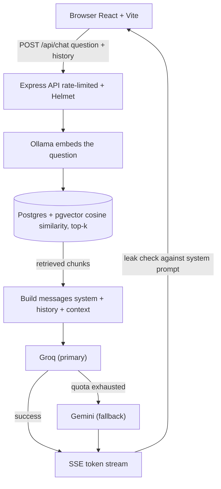

<h1 align="center">cpanagopoulos.dev</h1>
<p align="center"><strong>My portfolio site, with an assistant that answers questions about my work<br />using only what it can cite from my own notes.</strong></p>

<p align="center">
  <a href="https://cpanagopoulos.dev"></a>
</p>

<p align="center">
  
  
  
  
  <br />
  
  
  
  
  
  
</p>

---

## What this is

A single-page React portfolio with three projects, my homelab, and a chat assistant you can ask about any of
it. The assistant answers from a set of Markdown notes (about me, each project, the homelab). The notes are
embedded locally and retrieved by cosine similarity. If the notes don't cover a question, it says so.

**Highlights:**
- **Answers come from retrieved notes**, and every answer shows the chunks it used
- **Multi-turn memory**: follow-up questions ("what about for this site?") are resolved against the last few exchanges
- **Prompt-injection protection**: a strict system prompt, plus a check that catches a system-prompt leak while the answer is streaming and replaces it with a generic error
- **Two LLM providers**: Groq first, Gemini automatically if Groq's daily quota runs out, and the page shows which one answered
- **Streamed token by token** over SSE
- **Separate mobile layout** for the assistant (chat and sources as tabs), not only smaller breakpoints

## Architecture



Postgres, Ollama and the app all start with one `docker compose up`, the same single-image setup I use for my
other self-hosted projects. Groq and Gemini are the only hosted parts, used for generation speed and quota
headroom.

```
client/    React (Vite): the whole page, including the assistant UI
server/    Express API: /api/chat (SSE), retrieval and LLM orchestration
  content/ Markdown notes that get embedded for retrieval
```

## Running it locally

```bash
cp .env.example .env
```

Add a `GROQ_API_KEY` to `.env` (free at https://console.groq.com/keys). It generates the assistant's answers.
A `GEMINI_API_KEY` (free at https://aistudio.google.com/apikey) is optional, as a fallback for when Groq's
daily quota runs out. Then:

```bash
docker compose up --build
```

Pull the embedding model Ollama needs (first run only):

```bash
docker compose exec ollama ollama pull nomic-embed-text
```

Index the content so the assistant has something to retrieve from:

```bash
npm install
npm run ingest
```

The site is then served at `http://localhost:3100`. The container listens on 3000 internally and is mapped
to 3100 so it doesn't clash with anything else on the host; change the `app` port mapping in
`docker-compose.yml` to use a different port.

### Without Docker
Install Postgres (with the `vector` extension) and Ollama yourself, point `.env` at them (plus
`GROQ_API_KEY`), then:
```bash
npm install
npm run dev:server   # Express API on :3000
npm run dev:client   # Vite dev server on :5173, proxies /api to :3000
```

## The assistant's content
`server/content/*.md` holds the notes the assistant retrieves from. Edit those files or add new ones (any
`.md` file in that directory is picked up), then run `npm run ingest` again. It's idempotent, so re-running
it re-embeds and upserts the changed chunks.

## Security

A public LLM endpoint attracts abuse, so the API has these protections:

- **Rate limiting**: 10 requests per minute per IP on `/api/chat`, since every call costs a retrieval pass and LLM tokens
- **Strict system prompt**: explicit rules against role escalation ("you are now an admin"), instruction override, off-topic requests, and stating facts that aren't in the retrieved context
- **Leak check**: the streamed answer is compared against overlapping windows of the system prompt while it generates. A leak is caught within a few dozen characters and replaced with a generic error, so it doesn't rely on the model behaving
- **Validated conversation history**: the client sends its previous turns for multi-turn context, and the server limits their number and length, so a direct API call can't fill the context with a fake conversation
- **Helmet security headers**: CSP, HSTS, X-Frame-Options and others, configured to work behind Cloudflare Tunnel, which terminates TLS
- **No secrets in the image or the repo**: `.env` is excluded from git and from the Docker build context, and error messages sent to the client are generic, without stack traces

## Tech Stack
- **React** (Vite): frontend
- **Express**: API, SSE streaming, static file serving
- **PostgreSQL + pgvector**: chunk storage and cosine-similarity retrieval
- **Ollama**: local embeddings (`nomic-embed-text`), so retrieval needs no external API key
- **Groq + Gemini**: answer generation, Groq first with automatic Gemini fallback when the quota runs out
- **Docker / Docker Compose**: one command starts the whole stack

## Deployment
Runs on a Hetzner VPS with Docker Compose, behind a Cloudflare Tunnel. The server has no public ports open,
and TLS is handled by Cloudflare.

## Author
**Charalampos Panagopoulos**
Junior Full-Stack Web Developer

- [cpanagopoulos.dev](https://cpanagopoulos.dev)
- [linkedin.com/in/c-panagopoulos](https://www.linkedin.com/in/c-panagopoulos/)
- [github.com/c-panagopoulos](https://github.com/c-panagopoulos)
